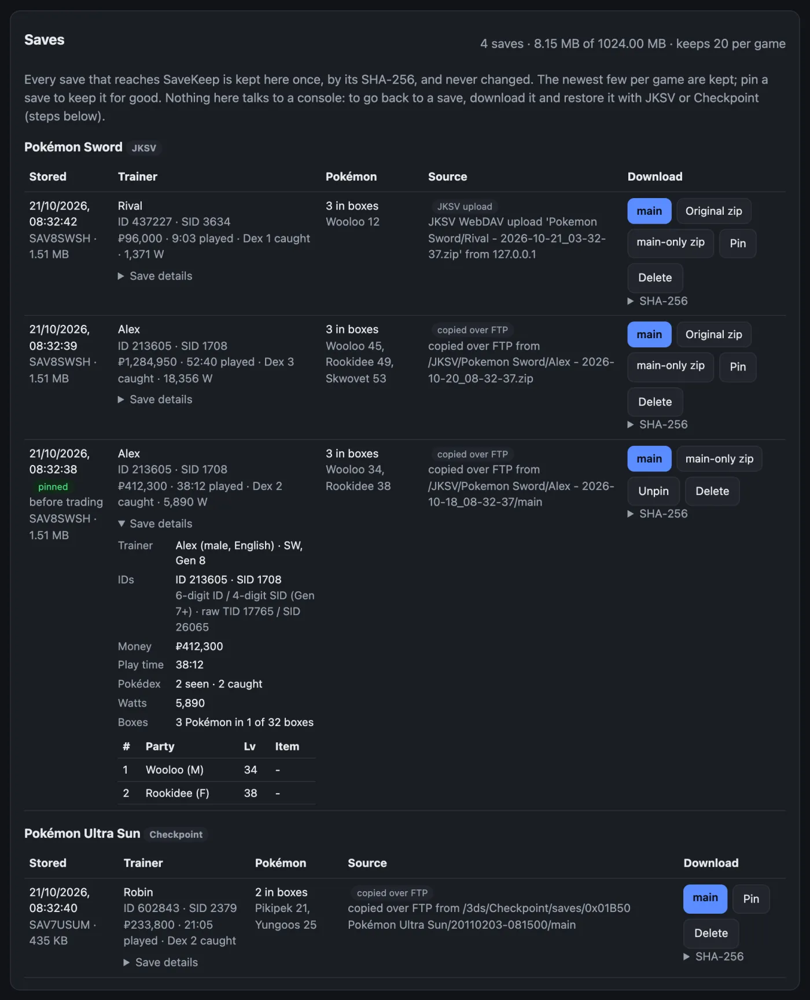
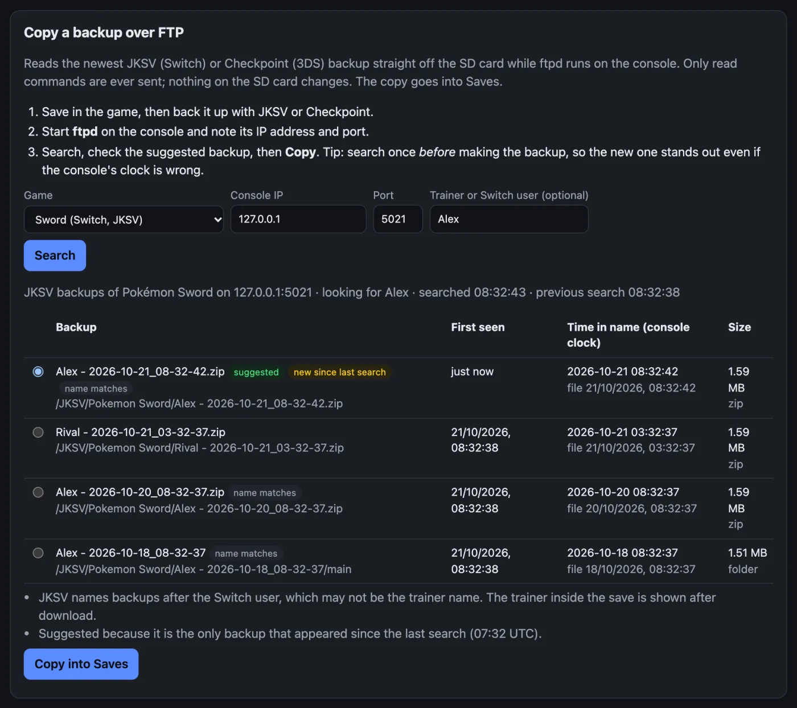
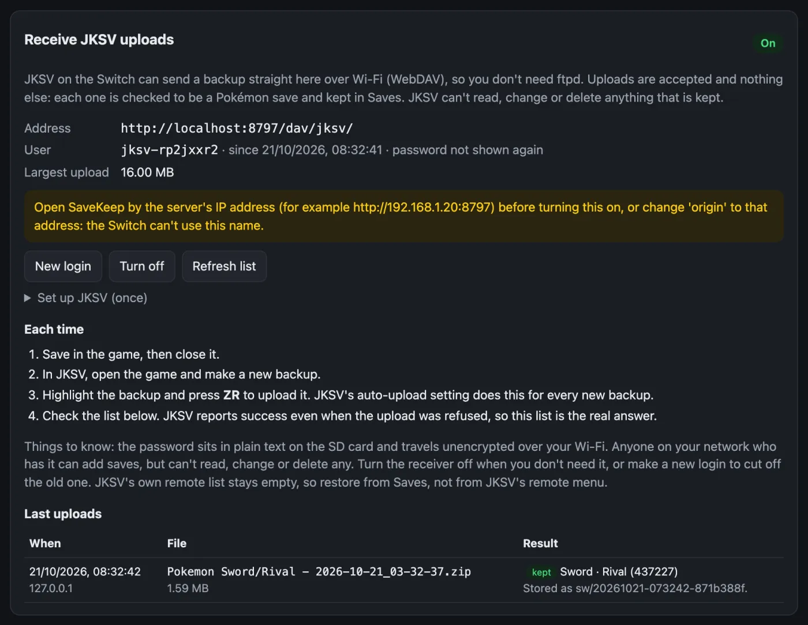

# SaveKeep

A small self-hosted vault for Pokémon save backups from a Switch or 3DS. It runs on anything that runs .NET 10 (I use a Raspberry Pi), stays on your local network, and keeps every save it is given exactly as it arrived.

Saves get in three ways:

- **JKSV upload.** JKSV on the Switch can push a backup over WebDAV. SaveKeep has a minimal, upload-only WebDAV endpoint for it, so pressing ZR on a backup in JKSV is enough.
- **Copy over FTP.** With ftpd running on the console, SaveKeep can find the newest JKSV (Switch) or Checkpoint (3DS) backup on the SD card and copy it. The FTP client can only send read commands.
- **Upload a file** from the browser.

Each save is read with [PKHeX.Core](https://github.com/kwsch/PKHeX), so the list shows what is actually in it: game, trainer name, ID and Secret ID, money, play time, Pokédex count, party and how many Pokémon are boxed. That makes it easy to tell ten backups of the same game apart.

SaveKeep never touches console memory and never writes to the console. To go back to a save you download it and restore it yourself with JKSV or Checkpoint; the page has the steps.



All the screenshots use made-up saves from the bundled simulator.

## How the vault behaves

- A save is stored once, keyed by the SHA-256 of `main`. The same save arriving again (another upload, the same backup copied twice) is recorded as "seen again", not stored twice.
- Nothing is ever modified after it is written. Later facts (seen again, pinned, unpinned) go into new files next to the save.
- Retention keeps the newest 20 saves per game and the whole vault under 1 GB (both configurable). The oldest go first. A game's newest save is never removed automatically, and neither is anything you pin. Pinning takes an optional note, like "before trading".
- Every download is checked against the stored hash, so a file that changed on disk is refused instead of served.
- Times come from the server's clock. Console clocks are often wrong (a 3DS that was never set still thinks it is 2011), so they are shown but never used for ordering.

On disk it looks like this:

```
data/
  vault/sw/20261020-120000-1a2b3c4d/
    main            the save
    original.zip    the JKSV zip it came in, if it came as one
    vault.json      what was read from it, where it came from, when
    events/         seen again, pinned, unpinned
  webdav/           receiver login (password hash only) and upload log
  audit.jsonl       everything that happened, one JSON line each
```

## Games

Any save PKHeX can read can be uploaded and kept. FTP search knows the folder layout and title IDs for Sword/Shield (JKSV) and Ultra Sun/Ultra Moon, Sun/Moon, X/Y and Omega Ruby/Alpha Sapphire (Checkpoint). Adding another game is one line in `src/SaveKeep.Core/Games/KnownGames.cs`.

## Running it

You need the .NET 10 SDK to build. To try it on your own machine without a console, start it with the bundled fake ftpd:

```bash
scripts/dev.sh
```

Then open http://localhost:8797, go to "Copy over FTP", pick Sword or Ultra Sun and search with IP `127.0.0.1` and port `5021`. The fake SD card has a few made-up backups; type `n` in the terminal to add a new one and see the "new since last search" suggestion work.



### On a Raspberry Pi (or any Linux box)

```bash
scripts/publish.sh linux-arm64
```

This runs the tests and builds a self-contained package in `dist/`. Copy `savekeep-linux-arm64.tar.gz` to the Pi, unpack it and run `sudo ./install.sh`. That creates a `savekeep` system user, installs to `/opt/savekeep`, keeps data in `/var/lib/savekeep` and starts a systemd service on port 8797. Running the installer again upgrades the app and leaves the data and config alone. Use `linux-x64` for a regular PC.

Settings live in `/etc/savekeep/savekeep.json`:

| Setting | Default | |
|---|---|---|
| `Urls` | `http://0.0.0.0:8797` | where the web page and WebDAV listen |
| `SaveKeep:DataDir` | `/var/lib/savekeep` | |
| `SaveKeep:VaultKeepPerGame` | 20 | saves kept per game (pinned saves are never removed) |
| `SaveKeep:VaultMaxTotalMB` | 1024 | size cap for the whole vault |
| `SaveKeep:FtpPort` | 5000 | ftpd's default on both consoles |
| `SaveKeep:AllowedHostNames` | `[]` | extra host names to accept, if you use one besides the IP, `localhost`, `*.local` or the machine name |

Environment variables work too, prefixed with `SAVEKEEP_` (`SAVEKEEP_SaveKeep__VaultKeepPerGame=50`).

## Setting up JKSV

1. On the "JKSV upload" tab, turn the receiver on. It shows a `webdav.json` with a random user name and password; the password is shown once and only its hash is stored.
2. Put that file on the Switch's SD card as `sd:/config/JKSV/webdav.json`. `origin` has to be the server's IP address (the Switch can't resolve `.local` names).
3. Start JKSV, check it says WebDAV started, and turn on "Export to ZIP" in its settings.
4. Back up a game, highlight the backup, press ZR. The upload list on the page shows whether it was kept or refused. JKSV says "uploaded" either way, so check the page.



Things worth knowing: JKSV only starts WebDAV if the Switch has internet access. The current JKSV only uploads zips. The receiver never lists files back, so JKSV's remote menu stays empty and can't overwrite or delete anything. `docs/jksv-webdav.md` has the exact requests both JKSV versions send.

## Security

This is meant for a home network and nothing else.

- Requests from outside private address ranges are refused, as are proxied requests and unexpected `Host` headers (DNS rebinding). The systemd unit adds the same restriction at the network level.
- Any request that changes something needs a custom header, so another web page can't make your browser do it.
- The WebDAV path is the only exception to that header rule, because JKSV can't send it. Every request there needs the receiver's login instead. After 20 wrong logins in ten minutes everything is refused for a while.
- The JKSV password sits in plain text on the SD card and travels unencrypted over Wi-Fi (JKSV speaks plain HTTP). Someone on your network with it can add saves, but can't read, change or delete any. Turn the receiver off when you don't use it, or make a new login to cut off the old one.
- There is no user login for the web page itself. Anyone on your LAN who can reach the port can see and download your saves and delete unpinned ones. Put it behind your own authentication if that matters to you.

## Tested so far

The receiver has been used with real JKSV on a Switch: WebDAV started and a ZR upload of a Sword backup was stored. The FTP commands it uses have been run against ftpd on both a Switch and a 3DS. Save details have been checked against real Sword and Ultra Sun saves. Restoring a downloaded save with JKSV or Checkpoint has not been tried yet, so keep the console's own backups as well. The test suite covers the rest against a simulated ftpd and a simulated JKSV client:

```bash
dotnet test tests/SaveKeep.Tests
```

## Licence

GPL-3.0-or-later, because PKHeX.Core is. See `THIRD-PARTY.md`.
